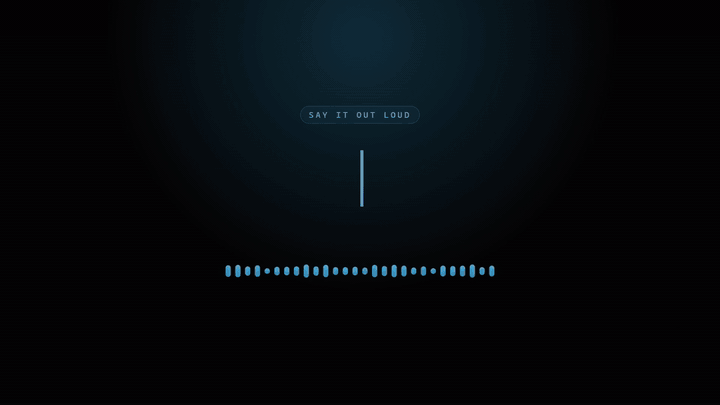
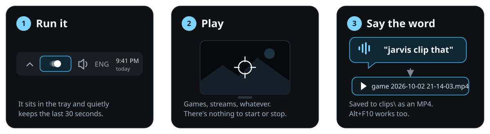
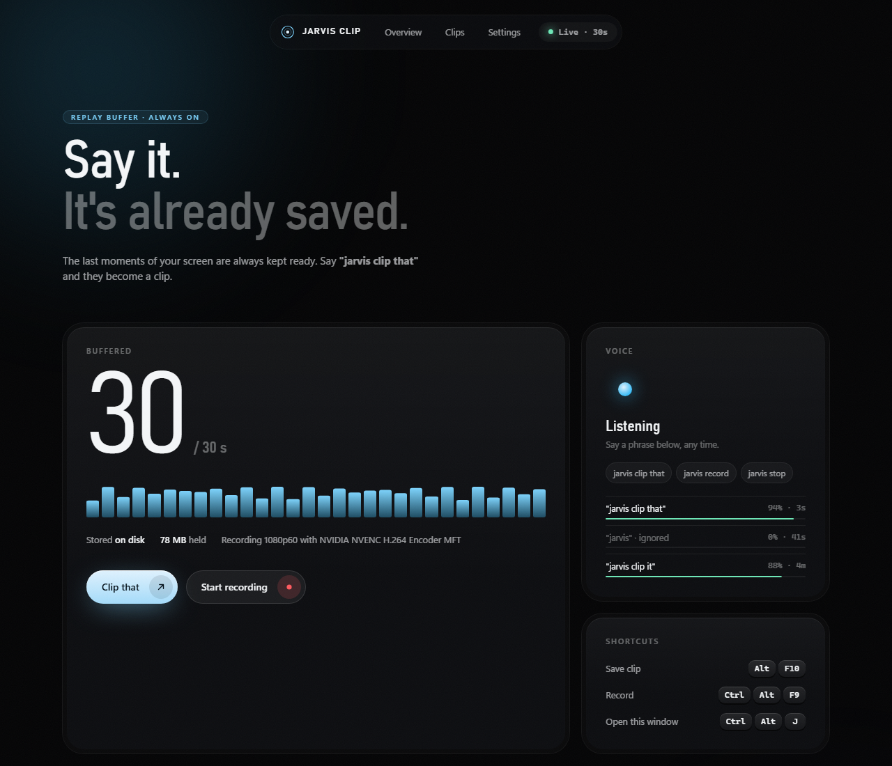
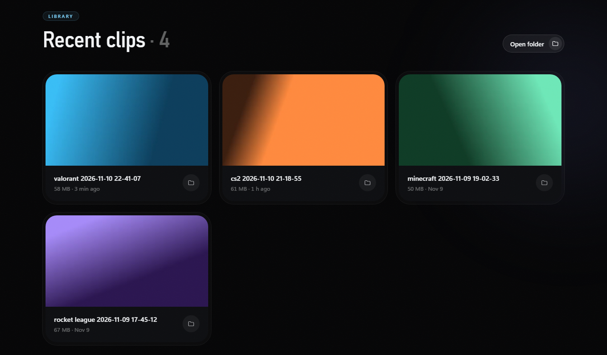
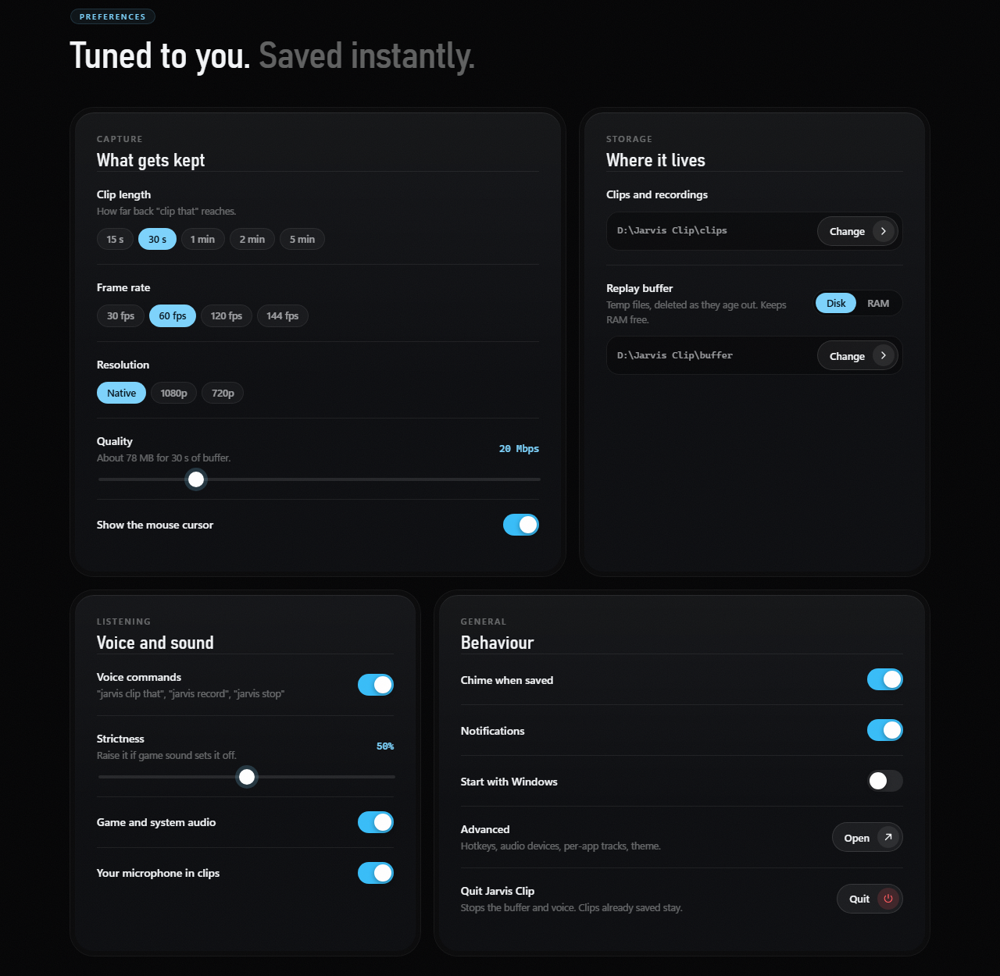
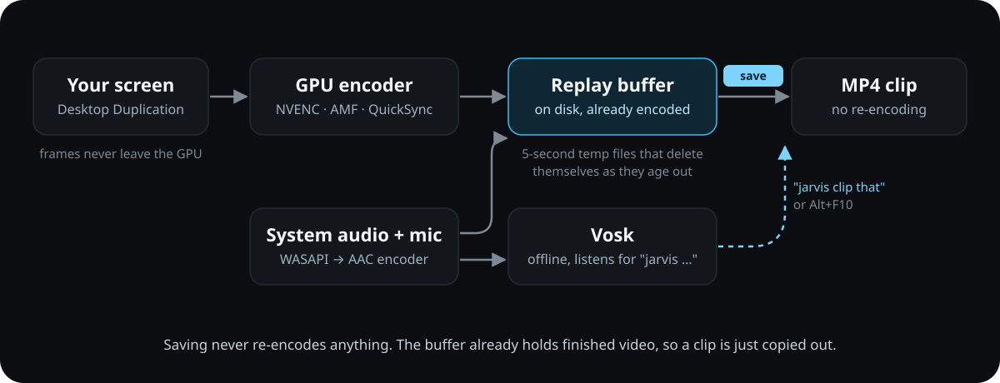

<p align="center">
  <a href="docs/demo.mp4"></a>
  <br><sub>Muted preview. <a href="docs/demo.mp4">Watch it with sound</a>.</sub>
</p>

<p align="center">
  <a href="../../releases/latest"></a>
  <a href="../../actions/workflows/build.yml"></a>
  
  <a href="LICENSE"></a>
</p>

**Jarvis Clip** always keeps the last 30 seconds of your screen and sound. When something
worth keeping happens, say **"jarvis clip that"** and it's saved as an MP4. No overlay,
no account, no background services, and the speech recognition runs offline on your PC.

- **Hands-free.** Voice commands for clips and recordings. It listens only for its own
  phrases, so game sound and talking rarely set it off.
- **Light.** Your GPU's video encoder does the work, and by default the buffer lives in
  small temp files on disk, not in RAM.
- **Instant.** Saving takes milliseconds because nothing gets re-encoded.
- **Portable.** Everything stays in the exe's folder. Nothing goes to AppData.

> Jarvis Clip is a fork of [**Bufferless**](https://github.com/veyzyn/bufferless) by veyzyn.
> The capture, encoding and MP4 engine are theirs; this fork adds voice commands, the
> disk buffer and the control window. Thanks, veyzyn.

## How to use it

<p align="center">
  
</p>

1. **Download** `jarvis-clip.exe` from the [latest release](../../releases/latest) into a
   folder of its own and run it. There's no installer. The first run fetches the
   [voice files](#voice-files) (~55 MB, once).
2. **Play**, stream, work, whatever. It's always keeping the last 30 seconds.
3. **Say "jarvis clip that"**, or press **Alt+F10**. You'll hear a short chime, and the clip
   lands in `clips\` next to the exe, named after whatever was on screen:
   `valorant 2026-11-10 22-41-07.mp4`.

Double-click the tray icon (or press **Ctrl+Alt+J**) to open the control window.

| Say | What happens |
| --- | --- |
| "jarvis clip that" / "jarvis clip it" / "jarvis clip" | Saves the last 30 seconds, a moment after you finish the phrase |
| "jarvis record" / "jarvis start recording" | Starts a full recording |
| "jarvis stop" / "jarvis stop recording" | Stops the recording and saves it |

> [!NOTE]
> The exe isn't code-signed, so Windows may say **"Windows protected your PC"** the
> first time. Click **More info**, then **Run anyway**.

### Voice files

Voice commands use [Vosk](https://alphacephei.com/vosk/), which is too big to put in the
exe. On the first run with voice on, Jarvis Clip downloads it from the official sources,
checks each download against a pinned SHA-256 hash, and unpacks it into a `vosk` folder
next to the exe:

- [vosk-win64-0.3.45.zip](https://github.com/alphacep/vosk-api/releases/tag/v0.3.45) (the DLLs)
- [vosk-model-small-en-us-0.15](https://alphacephei.com/vosk/models) (the English model, in `vosk\model`)

Offline PC? Unpack those two yourself into the same layout:

```
jarvis-clip.exe
vosk\libvosk.dll, libstdc++-6.dll, libgcc_s_seh-1.dll, libwinpthread-1.dll
vosk\model\...
```

If the download fails, voice is off and everything else still works. The control window
shows why.

## The control window

<p align="center">
  
</p>

The top shows how much is buffered and where, and what the voice recognizer just heard,
with its confidence. **Clip that** and **Start recording** do the same as the voice
commands. Close the window any time; the buffer keeps running in the tray.

<p align="center">
  
</p>

Your newest clips, with previews. Click one to play it right there.

## Settings

<p align="center">
  
</p>

Everything is saved as soon as you change it, to `config.toml` next to the exe.

**Clip length.** How far back "clip that" reaches, from 15 seconds to 20 minutes.

**Frame rate**, **Resolution** and **Quality.** Higher means sharper video and bigger
files. The window shows how much the buffer will hold.

**Replay buffer: Disk or RAM.** On disk, the buffer is a few temp files in `buffer\` that
delete themselves as footage ages out (and when the app exits or crashes). About 2.5 MB/s
of writes at the default quality. In RAM, nothing touches the disk but memory use grows
with the clip length. If the disk folder can't be written, the buffer falls back to RAM
and the window says so.

**Strictness.** How sure the recognizer must be before a phrase counts. If game sound
triggers it, raise it. The log (`jarvis-clip.log`) lists every phrase it heard.

**Voice uses your microphone setting.** Pick the mic under **Advanced**; voice listens on
the same one your clips record.

**Advanced** opens the classic settings window from Bufferless for hotkeys, audio
devices, per-app audio tracks, the theme and the save sound.

## Questions

<details>
<summary><b>It says the hotkey is unavailable</b></summary>

Another app already uses that shortcut. It's usually the NVIDIA overlay, which owns
Alt+F10 for its own Instant Replay. Turn that off, or pick a different hotkey under
**Settings → Advanced**. Voice commands work either way.
</details>

<details>
<summary><b>It didn't hear me / it fires on its own</b></summary>

Check the voice feed in the control window: it shows each phrase it heard and how sure
it was. If your phrases show up below the strictness level, lower it. If game sound
triggers it, raise it. Make sure the right microphone is picked under **Advanced**.
</details>

<details>
<summary><b>How do recordings work?</b></summary>

Say "jarvis record" (or press **Ctrl+Alt+F9**) to start and "jarvis stop" to finish. A
recording starts at the last second already in the buffer and is written to disk as it
goes, so it can be as long as you like. If the display mode changes mid-recording, it's
saved up to that point and you get a notification saying why.
</details>

<details>
<summary><b>How much memory does it use?</b></summary>

Measured on an i5-10300H laptop at 1080p60 and 20 Mbps:

| | Working set | Private (commit) |
| --- | --- | --- |
| Voice off, buffer on disk | ~160 MB | ~185 MB |
| Voice off, buffer in RAM | ~240 MB | ~335 MB |
| Voice on, buffer on disk | ~280 MB | ~560 MB |
</details>

<details>
<summary><b>Will it slow down my games?</b></summary>

Barely. Graphics cards have a separate chip just for encoding video, and that's what
does the heavy lifting. Bufferless measured about 3% of one CPU core at 1080p60; voice
adds the recognizer on top.
</details>

<details>
<summary><b>Why does my clip start a little early?</b></summary>

Video is stored in chunks that start every second, and a clip has to begin at the start
of a chunk. So you might get up to one extra second at the beginning.
</details>

## How it works

<p align="center">
  
</p>

The trick, from Bufferless, is that the buffer holds *finished* video, not raw frames.
Your screen is grabbed with Windows' Desktop Duplication, compressed by the GPU's
hardware encoder, and the result goes into a rolling buffer. Saving a clip copies that
into an MP4, so it takes milliseconds and looks exactly as it was recorded.

Jarvis Clip writes the buffer to 5-second temp files opened delete-on-close, keeping
only a small index in memory. The mic is also fed to Vosk with a fixed grammar of the
Jarvis phrases (plus "unknown" for everything else), so it ignores normal talk. The
control window is a page the app serves on `127.0.0.1`, shown in a Chrome, Edge or
Brave `--app` window that only runs while it's open.

<details>
<summary><b>Building from source</b></summary>

You need Windows 10 or 11 and [Rust](https://rustup.rs).

```
cargo build --release
```

That gives you `target\release\jarvis-clip.exe`. `cargo test` runs the tests;
`cargo test -- --ignored` adds one that needs Windows 11 and an audio device.

With the GNU toolchain instead of MSVC, run `bash build.sh`. It needs binutils (`as`,
`dlltool`, `windres`) on PATH and copies the exe to `dist\`. Put machine-specific
settings (`CARGO_HOME`, `PATH`, ...) in `build.local.sh`, which git ignores.

To test voice without a mic, set `JARVIS_VOICE_WAV` to a 16 kHz mono 16-bit `.wav`:
the app feeds it to the recognizer instead.

Every push to `main` is tested, built and published as a release with the next patch
version (v0.1.1, v0.1.2, ...); push a tag like `v0.2.0` yourself for a bigger jump.

| File | What's in it |
| --- | --- |
| `src/voice.rs` | Voice commands (Vosk) |
| `src/ui.rs`, `src/ui.html` | The control window |
| `src/ring.rs` | The replay buffer, in RAM or spooled to disk |
| `src/capture.rs` | Screen capture, GPU colour conversion, frame timing |
| `src/encoder.rs` | Hardware H.264 encoder |
| `src/audio.rs` | System audio, mic and per-app capture, mixing, AAC encoding |
| `src/mux.rs` | MP4 writer |
| `src/record.rs` | Recordings, streamed to disk |
| `src/app.rs` | Tray icon, hotkeys, saving clips |
| `src/settings.rs` | The classic settings window |
| `src/rt.rs` | Small Win32 wrappers for files, threads and locks |
</details>

## Credits and license

Jarvis Clip is built on [Bufferless](https://github.com/veyzyn/bufferless) by veyzyn
(MIT). Voice recognition is [Vosk](https://alphacephei.com/vosk/) by Alpha Cephei
(Apache 2.0). See [THIRD-PARTY-NOTICES.md](THIRD-PARTY-NOTICES.md).

[MIT](LICENSE). Do whatever you like with it, just keep the copyright notices.
